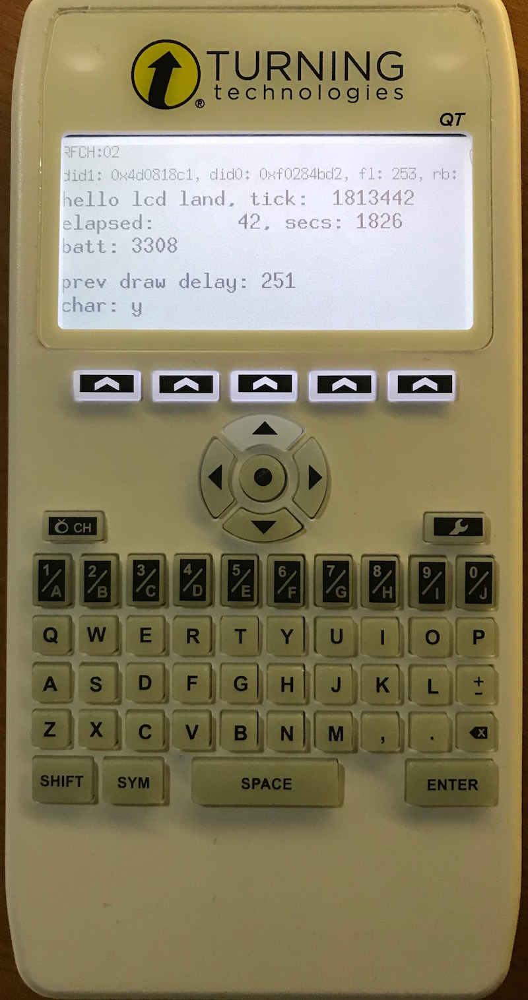
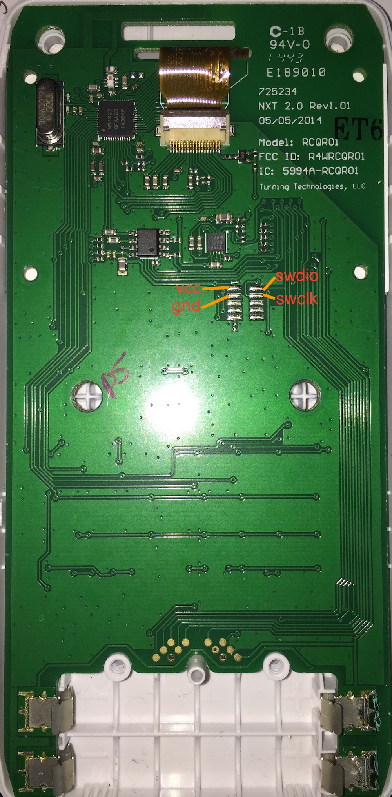

# RCQR-01 demo software
Turning Technologies QT "clicker" (RCQR-01) hardware and software exploration (WIP).
My adventures in reverse engineering an interesting platform.



## hardware
* based on nrf51822 (QFAA, 16kB ram, 256kB flash, Cortex M0)
* low ram (non 32k model) makes it very tricky to run any BLE softdevice.

### Display
 * lcd 340x160 ?, 2-bit grayscale ?
 * maybe ST7586 chipset? connected to serial bus. Use SPI to transfer data to chip.
 * custom u8g2/u8x8 driver for the ST7586
 * unusual pixel column format (packed 3 pixels per byte)
 * one-page 1bpp buffer, 340 bytes, to keep RAM usage low
 * Microchip MCP1256 3.3v boost converter/regulator powers lcd stuff
 
### eeprom
 * CAT25512 512-Kb SPI Serial CMOS EEPROM
 
### keyboard
 * 8x8 matrix, qwerty style. Glow-in-the-dark keypad is a neat touch.
 * rows have external pullups?
 
### pinout

| nRF51822 gpio | component     | | nRF51822 gpio | component     |
|---------------|---------------|-|---------------|---------------|
| 00            | EEP_CK        | | 16            | EEP_SO        |
| 01            | LCD_CS        | | 17            | KEY_COL3      |
| 02            | LCD_RST       | | 18            | KEY_ROW1      |
| 03            | LCD_DC        | | 19            | KEY_ROW2      |
| 04            | LCD_MISO      | | 20            | KEY_ROW3      |
| 05            | LCD_MOSI      | | 21            | KEY_ROW4      |
| 06            | LCD_RW        | | 22            | KEY_ROW5      |
| 07            | LCD_SCK       | | 23            | KEY_ROW6      |
| 08            | KEY_ROW0      | | 24            | KEY_ROW7      |
| 09            | KEY_COL0      | | 25            | KEY_COL4      |
| 10            | KEY_COL1      | | 26            | KEY_COL5      |
| 11            | KEY_COL2      | | 27            | MCP1256_SHDN  |
| 12            | EEP_CS        | | 28            | KEY_COL6      |
| 13            | LCD_BACKLIGHT | | 29            | KEY_COL7      |
| 14            | MCP1256_PGOOD | | 30            | EEP_SI        |
| 15            | MCP1256_SLEEP |

### programming
see picture below
### inside
* unpopulated cortex debug connector pad - only vcc, gnd, swdio, swdclk populated
#### battery compartment
* test points pad pinout (from left to right - ignore the pins with the larger holes)

| pad | destination |
|-----|-------------|
| 1   | SWDIO/nRST  |
| 2   | SWDCLK      |
| 3   | EEP_SO      |
| 4   | EEP_SI      |
| 5   | EEP_CLK     |
| 6   | EEP_CS      |
| 7   | P0.20 ?     |
| 8   | P0.19 ?     |
| 9   | GND         |
| 10  | VCC 3V3     |

## pics
### pcb rear


## software
* build system is VS Code + [PlatformIO](https://platformio.org/)
* target environment is `nrf51_rcqr01_standalone`
* use an external nRF5 SDK 12.3.0 checkout at `../nRF5_SDK_12.3.0_d7731ad`
* prepare and verify the SDK once:
  ```sh
  python3 scripts/setup_sdk.py
  ```
  Set `NRF_SDK_DIR` in `.env` or pass `--sdk /path/to/sdk` if it is elsewhere.
* build with:
  ```sh
  python3 -m platformio run -e nrf51_rcqr01_standalone
  ```
* use ST-Link for flashing/debugging; SEGGER RTT remains available for logging
* display rendering uses [u8g2](https://github.com/olikraus/u8g2) with a project-specific ST7586 u8x8 driver

### Graphics

The display is initialized by `display_init()` in `src/display.c`. The custom
`src/u8x8_d_st7586_rcqr01.c` driver handles the 340x160 panel geometry, the
hidden controller columns, and the panel's three-pixels-per-byte format.
Rendering uses u8g2 page mode with a 360-byte buffer. The application uses
`u8g2_font_6x10_tf` for small text and `u8g2_font_10x20_tf` for larger text.

The Nordic SDK sources required by PlatformIO are selected in
`src/sdk_includes.c` and compiled directly from the external SDK checkout.
The PlatformIO pre-build script validates the SDK path and configures all
include and linker paths from the same root.

## SDK patches

The project uses nRF5 SDK 12.3.0. `scripts/setup_sdk.py` applies and verifies
the three compatibility fixes needed by this project:

1. Fix the ESB channel getter name in `components/proprietary_rf/esb/nrf_esb.h`
2. Use `SWI3` for the app timer handler in `components/libraries/timer/app_timer.c`
3. Read the ESB address bytes bytewise in `components/proprietary_rf/esb/nrf_esb.c`.
   `m_esb_addr` has byte alignment, so the SDK's 32-bit load can become an
   unaligned access; the Cortex-M0 then hard-faults during `radio_init()`.

The SDK root defaults to:

```text
../nRF5_SDK_12.3.0_d7731ad
```

Set `NRF_SDK_DIR` in `.env`, or pass `--sdk` to the setup script, to use a
different checkout. The historical patches remain under `patches/` as
documentation of the required changes; the setup script applies the equivalent
edits idempotently.

## TODOs
* improve standby/sleep modes and decrease current draw. Currently get avg <1mA when display sleeping, which is good enough for me. (The 1ms timer tick is wasteful - maybe move to 10ms?)
* verify the current firmware on hardware with the display, keypad, radio, EEPROM, and RTT checklist in `docs/plans/u8g2-migration.md`

## references

 * [nrf51822 product specification datasheet](http://infocenter.nordicsemi.com/pdf/nRF51822_PS_v3.1.pdf)
 * [nrf51 reference manual](http://infocenter.nordicsemi.com/pdf/nRF51_RM_v3.0.pdf)
 * [nordic nrf51 sdk 12.3.0](http://infocenter.nordicsemi.com/topic/com.nordic.infocenter.sdk5.v12.3.0/index.html)
   * this repo includes patch files under `patches/` for the known SDK fixes used by the project
 * [CAT25512 datasheet](http://www.onsemi.com/pub/Collateral/CAT25512-D.PDF)
 * [ST7586 datasheet](https://www.buydisplay.com/download/ic/ST7586.pdf)
 * [MCP1256 datasheet](http://ww1.microchip.com/downloads/en/DeviceDoc/21989a.pdf)

 
